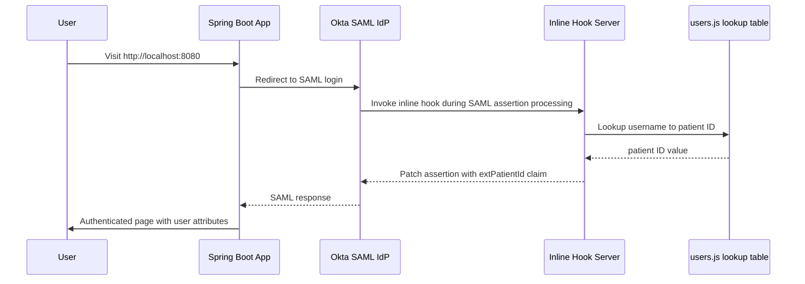

# Okta SAML + Inline Hook Demo

This project demonstrates a full login flow where a Java Spring Boot application initiates an Okta SAML login, and Okta validates the user through a custom SAML inline hook before returning the authentication response.

The app uses:

- Spring Boot 3 and Spring Security SAML 2 Service Provider
- Okta as the SAML identity provider
- A Node.js Express endpoint that acts as an Okta inline hook
- A username-to-patient mapping that injects a custom `extPatientId` attribute into the SAML assertion

## High-level flow



## What this project does

The Java application is the service provider. When a user visits the site, Spring Security redirects the user to Okta for SAML authentication.

During that SAML assertion lifecycle, Okta calls the configured inline hook endpoint in [server.js](server.js). That hook:

- reads the user's login email from the Okta request body
- looks up the user in [users.js](users.js)
- injects a custom claim named `extPatientId` into the SAML assertion using the Okta assertion patch format
- returns a JSON command that Okta applies to the assertion

After the assertion is modified, the Spring application receives the SAML response and displays the authenticated user attributes on the home page.

## Project structure

- [src/main/java/com/example/demo/SecurityConfiguration.java](src/main/java/com/example/demo/SecurityConfiguration.java) – Spring Security SAML configuration
- [src/main/java/com/example/demo/HomeController.java](src/main/java/com/example/demo/HomeController.java) – displays the logged-in user and attributes
- [src/main/resources/application.yml](src/main/resources/application.yml) – Okta SAML metadata and signing certificate configuration
- [src/main/resources/templates/home.html](src/main/resources/templates/home.html) – authenticated user landing page
- [server.js](server.js) – Express app that handles the Okta inline hook
- [users.js](users.js) – sample user-to-patient ID mapping used by the hook
- [build.gradle](build.gradle) – Java build and Spring Boot dependencies
- [package.json](package.json) – Node.js dependency setup for the hook server

## Prerequisites

Before running the project, make sure you have:

- Java 17
- Gradle or the Gradle wrapper included in the repo
- Node.js 18+ and npm
- An Okta developer org
- A public HTTPS URL for the inline hook endpoint (for example, via ngrok)

## Configuration

### 1) Java/Spring configuration

The Spring app is configured in [src/main/resources/application.yml](src/main/resources/application.yml). Update the Okta metadata URL to match your Okta app:

```yaml
spring:
  security:
    saml2:
      relyingparty:
        registration:
          okta:
            assertingparty:
              metadata-uri: https://your-okta-domain.okta.com/app/your-app-id/sso/saml/metadata
```

The project also expects the local SAML signing certificate and private key in the classpath:

- [src/main/resources/local.crt](src/main/resources/local.crt)
- [src/main/resources/local.key](src/main/resources/local.key)

If those files are missing, generate or replace them with a valid keypair for your app.

### 2) Node inline hook configuration

The custom hook server runs on port 3000 by default and listens on the `/SAMLHook` endpoint in [server.js](server.js).

Create a `.env` file in the project root:

```bash
HOOK_AUTH_HEADER=Authorization
HOOK_AUTH_SECRET=your-shared-secret
PORT=3000
```

The secret must match the value configured in your Okta inline hook.

### 3) User mapping

Edit [users.js](users.js) to match the users that are allowed to receive a custom claim:

```js
const users = [
  { username: 'user1@example.com', ExternalServicePatientID: 123456 },
  { username: 'user2@example.com', ExternalServicePatientID: 1001 }
];
```

The inline hook checks the user's login value from Okta and adds the patient ID claim only when the username exists in this list.

## Okta setup

### Create the SAML app

In Okta:

1. Go to Applications > Create App Integration
2. Select SAML 2.0
3. Name the app and complete the SAML form
4. Set the Single sign-on URL to:

```text
http://localhost:8080/login/saml2/sso/okta
```

5. Set the Audience URI to:

```text
http://localhost:8080/saml2/service-provider-metadata/okta
```

6. Assign the app to users or groups
7. Download the IdP metadata and copy the metadata URL into the Spring configuration

### Configure the inline hook

Create an inline hook in Okta for the SAML assertion pipeline.

Set the endpoint to your public URL, for example:

```text
https://your-ngrok-id.ngrok-free.app/SAMLHook
```

Use the same shared secret value from your `.env` file and the `Authorization` header.

The hook must return a patch command in the format used by Okta's assertion patch API, which is exactly what [server.js](server.js) does.

## Run the project

### 1) Install Node dependencies

```bash
npm install
```

### 2) Start the inline hook server

```bash
npm start
```

The server will listen on port 3000 by default.

If you need a public URL for Okta, expose it using ngrok:

```bash
ngrok http 3000
```

### 3) Start the Spring Boot app

From the project root:

```bash
./gradlew bootRun
```

Then open:

```text
http://localhost:8080
```

You should be redirected to Okta for authentication. After successful login, the app displays the current user and available SAML attributes.

## Notes on the SAML assertion patch

The custom inline hook adds the claim:

```json
{
  "type": "com.okta.assertion.patch",
  "value": [
    {
      "op": "add",
      "path": "/claims/extPatientId",
      "value": {
        "attributes": {
          "NameFormat": "urn:oasis:names:tc:SAML:2.0:attrname-format:unspecified"
        },
        "attributeValues": [
          {
            "value": 123456
          }
        ]
      }
    }
  ]
}
```

This custom claim is then available to the Spring service provider as part of the authenticated principal.

## Troubleshooting

- If Spring Boot fails to start, confirm Java 17 is active and `JAVA_HOME` is set correctly.
- If the inline hook returns 401, verify the `Authorization` header value matches the secret in Okta and `.env`.
- If Okta does not call the hook, confirm the endpoint is public and reachable over HTTPS.
- If the assertion patch is not applied, verify the username exists in [users.js](users.js) and matches the Okta login field exactly.

## License

This project is distributed under the Apache 2.0 license. See [LICENSE](LICENSE) for details.

